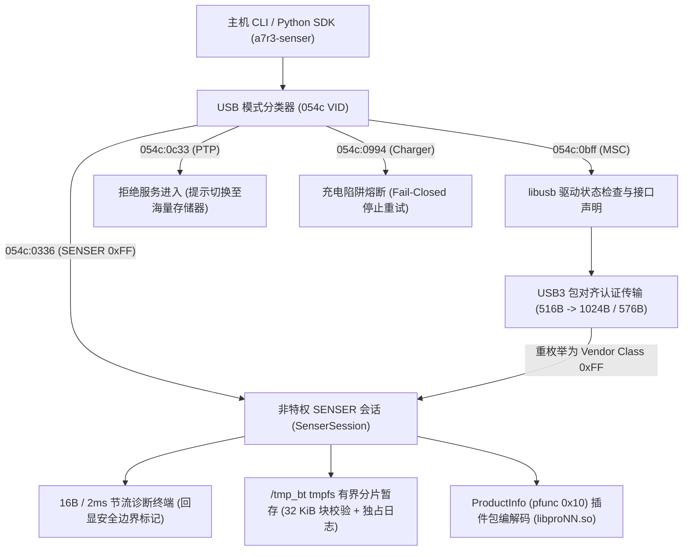

# `a7r3-usb-senser` — Sony A7R3 连接处理与服务会话基础设施

`a7r3-usb-senser` 是面向 **Sony Alpha 7R III (`ILCE-7RM3`)** 的主机到相机 USB 模式分类、**USB 3.1 SuperSpeed `516B -> 1024B/576B` 包对齐认证传输层**、libusb 驱动状态管理以及 SENSER 节流诊断终端与 `/tmp_bt` 内存暂存会话 SDK。

> [!CAUTION]
> **硬件与数据安全红线**
> 1. 本仓库**不包含任何 Sony 专有固件二进制文件（`.so`/`.elf`/`.ko`/`.bin`）**，亦不内嵌第三方 `Sony-PMCA-RE` 源码（通过环境变量 `SONY_PMCA_ROOT` 按需外部引用）。
> 2. 操作实机前请务必完整阅读 [`docs/usb-hazards.md`](docs/usb-hazards.md)：严禁在低电量 `054c:0994`（USB Charger）陷阱态下强行重试；严禁将高频临时文件写入持久化 VFAT 分区 `/tmp`（必须使用真 `tmpfs` `/tmp_bt`）；严禁操作 `/sys/class/udc/dwc3.0/soft_connect`！

---

## 免责声明

> 大家请以学习为目的使用本仓库⚠️⚠️⚠️⚠️，[安全研究法律边界与合规须知](./DISCLAIMER.md#法规与合规参考)
>
> 本仓库的所有内容仅供学习和参考之用，禁止用于商业用途。任何人或组织不得将本仓库的内容用于非法用途或侵犯他人合法权益。本仓库所涉及的固件分析、系统逆向与硬件接口研究技术仅用于个人合法自有设备上的学习与研究，不得用于未经授权侵入或破坏他人设备、绕过技术保护措施、提取或传播第三方专有固件或其他非法行为。对于因使用本仓库内容而引起的任何法律责任、硬件损坏（变砖）、数据丢失或保修失效，本仓库及作者不承担任何责任。使用本仓库的内容即表示您同意本免责声明的所有条款和条件。
>
> 点击查看更为详细的免责声明。[点击跳转](./DISCLAIMER.md)

---

## 系统架构



---

## 目录结构

```text
a7r3-usb-senser/
├── DISCLAIMER.md                    # 详细法律合规与硬件风险免责声明
├── LICENSE                          # MIT 许可证 + 商标与硬件安全声明
├── Makefile                         # 离线单元测试与清理入口
├── pyproject.toml                   # 标准 PEP 621 打包配置与 a7r3-senser CLI 入口
├── docs/
│   └── usb-hazards.md               # 054c:0994 陷阱、/tmp vs /tmp_bt、soft_connect 禁用详解
├── src/a7r3_senser/
│   ├── __init__.py                  # SDK 公共导出接口
│   ├── transport.py                 # USB 模式分类、516B->1024B/576B 对齐读取、MSC->SENSER 状态机
│   ├── terminal.py                  # 16B/2ms 节流写入、ordered_terminal_markers()、终端恢复
│   ├── session.py                   # SenserSession、/tmp_bt 有界暂存、ProductInfo 0x10 插件辅助
│   ├── driver.py                    # 主机 USB 驱动探测/解绑/恢复与只读元数据采集
│   └── cli.py                       # a7r3-senser 命令行工具
└── tests/                           # 100% 离线自包含单元测试 (无需连接相机或专有固件)
    ├── test_transport.py
    └── test_terminal_and_staging.py
```

---

## 快速开始与环境变量配置

### 1. 安装与运行离线测试

无需连接相机或安装外部固件文件，直接运行完整离线测试套件：

```bash
make test
```

如需启用实际 USB 通信功能，请在虚拟环境中安装可选 USB 依赖并指定外部 `Sony-PMCA-RE` 路径：

```bash
pip install -e ".[usb,dev]"
export SONY_PMCA_ROOT="/path/to/Sony-PMCA-RE"
export A7R3_USB_SERIAL="YOUR_CAMERA_USB_SERIAL"
```

### 2. CLI 常用命令示例

```bash
# 1. 枚举当前连接的 Sony USB 设备并自动识别模式 (MSC / PTP / SENSER / CHARGER)
a7r3-senser list

# 2. 只读校验 MSC 设备描述符与端点包长 (不解绑驱动、不发送切换指令)
a7r3-senser enter --serial "$A7R3_USB_SERIAL" --dry-run

# 3. 从 Mass Storage (054c:0bff) 切换至 SENSER 服务模式 (054c:0336)
sudo SONY_PMCA_ROOT="$SONY_PMCA_ROOT" a7r3-senser enter \
    --serial "$A7R3_USB_SERIAL" \
    --report /tmp/a7r3-entry-report.json

# 4. 异常中断后请求恢复主机海量存储内核驱动并轮询验证
sudo a7r3-senser restore --serial "$A7R3_USB_SERIAL"
a7r3-senser verify-restore --serial "$A7R3_USB_SERIAL"
```

### 3. Python 会话与 `/tmp_bt` 内存暂存示例

当相机已枚举为 `054c:0336`（USB Vendor-Specific `0xFF`）时：

```python
import hashlib
from pathlib import Path
from a7r3_senser import SenserSession

payload = b"\x7fELF..."  # 自行编译且通过 DT_RELCOUNT=0 审计的模块字节
digest = hashlib.sha256(payload).hexdigest()

with SenserSession(enable_terminal=True) as sess:
    # 16B / 2ms 节流安全执行诊断命令，自动过滤终端回显干扰
    mounts = sess.terminal.execute("cat /proc/mounts")
    assert b"none /tmp_bt tmpfs " in mounts

    # 将模块安全分片上传至易失性 /tmp_bt (绝不触碰持久化 /tmp)
    staged_paths = sess.stage_ram_bundle(
        {"libcustom_probe.so": (payload, digest)},
        label="probe-trial",
        journal_path=Path("./stage-journal.json"),
    )

    # 通过 ProductInfo (pfunc 0x10) 发送 0xFA00 插件指令
    status, reply = sess.send_plugin(0xFA00, b"PING_PAYLOAD")
```

---

## 安全警告与故障恢复准则

1. **绝不在未知连接状态下自动重放写操作**：若 USB 传输抛出 `USBError(5, 'Input/Output Error')` 或超时，主机侧无法仅凭异常区分“命令未送达”与“相机正在重启”。必须将当前会话标记为 `STOPPED_NO_RETRY`，重新枚举并验证 `boot_id` 与文件哈希后再决定下一步。
2. **保持电量充足**：进入服务会话前建议机身电量 `>= 50%`，防止调试中途跌入 `054c:0994` 充电模式。
3. **退出会话自动释放句柄**：请始终使用 `with SenserSession(...)` 上下文管理器，确保退出时执行 `auth.stop()`，触发机身 `libsencore.so` 自动 `dlclose` 会话期间加载的插件句柄并恢复正常 USB 模式。
